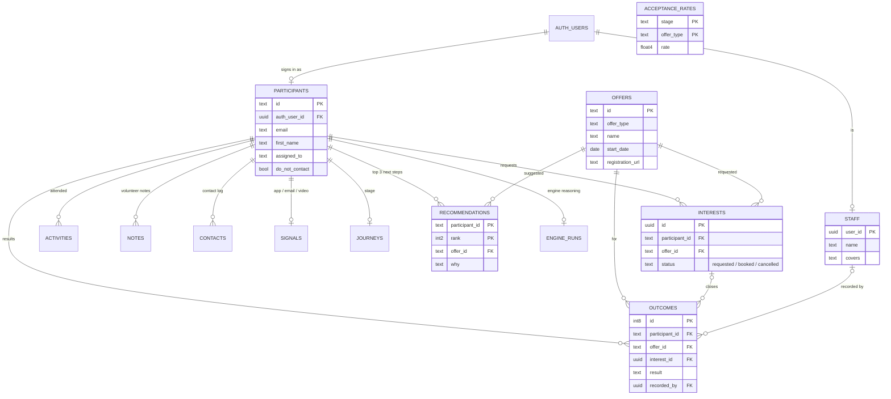

# Database schema

Supabase (Postgres) project used by the website and the engine. Source of truth: the SQL files in
[`supabase/migrations/`](../supabase/migrations/) (`0001_schema.sql` … `0006_contact_details.sql`).
The column and policy tables below were exported from the Supabase dashboard on 2026-11-15 and checked
against those migrations.

## How the tables connect

Every participant-owned table is deleted with its participant (`on delete cascade`). A sign-in account is
linked to its `participants` row automatically when the emails match (trigger `on_auth_user_created`).
`acceptance_rates` stands alone: the learning loop updates it from `outcomes`.

## Views

All views use `security_invoker = true`, so the table rules below still apply to whoever reads them.

| View | Used by | What it returns |
|---|---|---|
| `next_steps` | Participant site | The signed-in person's top 3 next steps, already in the website's `NextStep` shape |
| `coordinator_queue` | Coordinator site | One row per participant request (`interests`), with the person and offer details; staff only, limited to the people a coordinator covers |
| `coordinator_people` | Coordinator site | Everyone a coordinator covers: stage, drift date, all three next steps, contact details and consent, latest request and outcome |

## Who can see what (summary)

| Table | Participant (signed in) | Staff |
|---|---|---|
| `participants`, `activities`, `journeys`, `recommendations` | Own rows only | All |
| `interests` | Own rows: read, create, update (cancel) | All: read, update (confirm / release) |
| `offers` | All | All |
| `notes`, `contacts`, `signals`, `engine_runs`, `outcomes` | Nothing | All |
| `acceptance_rates`, `staff` | Nothing | Read |

The engine writes with the service-role key from a GitHub Actions secret (bypasses RLS); that key is never
in the website. Tests for these rules: `supabase/tests` (`node run.mjs` → `ALL RLS CHECKS PASSED`).

---

## Table `participants`

### Columns

| Name | Type | Constraints |
|------|------|-------------|
| `id` | `text` | Primary |
| `auth_user_id` | `uuid` |  Nullable Unique |
| `email` | `text` |  Unique |
| `first_name` | `text` |  |
| `last_name` | `text` |  Nullable |
| `city` | `text` |  Nullable |
| `province` | `text` |  Nullable |
| `language` | `text` |  |
| `assigned_to` | `text` |  Nullable |
| `joined_at` | `date` |  Nullable |
| `skills` | `_text` |  |
| `interests` | `_text` |  |
| `preferred_channel` | `text` |  Nullable |
| `preferred_channel_source` | `text` |  Nullable |
| `email_opt_in` | `bool` |  |
| `whatsapp_opt_in` | `bool` |  |
| `phone_opt_in` | `bool` |  |
| `do_not_contact` | `bool` |  |
| `created_at` | `timestamptz` |  |
| `phone` | `text` |  Nullable |

## Table `staff`

### Columns

| Name | Type | Constraints |
|------|------|-------------|
| `user_id` | `uuid` | Primary |
| `name` | `text` |  |
| `email` | `text` |  |
| `created_at` | `timestamptz` |  |
| `covers` | `text` |  Nullable |

## Table `activities`

### Columns

| Name | Type | Constraints |
|------|------|-------------|
| `id` | `int8` | Primary Identity |
| `participant_id` | `text` |  |
| `date` | `date` |  |
| `activity_type` | `text` |  |
| `name` | `text` |  |
| `subtype` | `text` |  Nullable |
| `city` | `text` |  Nullable |
| `source` | `text` |  Nullable |
| `source_id` | `text` |  Nullable |

## Table `notes`

### Columns

| Name | Type | Constraints |
|------|------|-------------|
| `id` | `int8` | Primary Identity |
| `participant_id` | `text` |  |
| `note` | `text` |  |
| `author` | `text` |  Nullable |
| `created_at` | `timestamptz` |  |

## Table `contacts`

### Columns

| Name | Type | Constraints |
|------|------|-------------|
| `id` | `int8` | Primary Identity |
| `participant_id` | `text` |  |
| `at` | `timestamptz` |  |
| `channel` | `text` |  |
| `direction` | `text` |  |
| `summary` | `text` |  Nullable |

## Table `signals`

### Columns

| Name | Type | Constraints |
|------|------|-------------|
| `participant_id` | `text` | Primary |
| `app_opens_30d` | `int4` |  |
| `email_opens_30d` | `int4` |  |
| `whatsapp_replies_30d` | `int4` |  |
| `video_minutes_30d` | `int4` |  |
| `invites` | `int4` |  |
| `updated_at` | `timestamptz` |  |

## Table `offers`

### Columns

| Name | Type | Constraints |
|------|------|-------------|
| `id` | `text` | Primary |
| `offer_type` | `text` |  |
| `name` | `text` |  |
| `program_key` | `text` |  Nullable |
| `commitment` | `int2` |  |
| `start_date` | `date` |  Nullable |
| `start_time` | `time` |  Nullable |
| `duration_min` | `int4` |  Nullable |
| `city` | `text` |  Nullable |
| `venue` | `text` |  Nullable |
| `languages` | `_text` |  |
| `tags` | `_text` |  |
| `prerequisites` | `_text` |  |
| `audience` | `text` |  Nullable |
| `registration_url` | `text` |  Nullable |
| `description` | `text` |  Nullable |
| `source` | `text` |  Nullable |
| `active` | `bool` |  |

## Table `journeys`

### Columns

| Name | Type | Constraints |
|------|------|-------------|
| `participant_id` | `text` | Primary |
| `stage` | `text` |  |
| `generated_at` | `timestamptz` |  |

## Table `recommendations`

### Columns

| Name | Type | Constraints |
|------|------|-------------|
| `participant_id` | `text` | Primary |
| `rank` | `int2` | Primary |
| `offer_id` | `text` |  |
| `name` | `text` |  |
| `kind` | `text` |  |
| `when_label` | `text` |  |
| `why` | `text` |  |
| `start_at` | `timestamp` |  Nullable |
| `duration_min` | `int4` |  Nullable |
| `online` | `bool` |  |
| `generated_at` | `timestamptz` |  |

## Table `engine_runs`

### Columns

| Name | Type | Constraints |
|------|------|-------------|
| `participant_id` | `text` | Primary |
| `journey_stage` | `text` |  Nullable |
| `stage_confidence` | `float4` |  Nullable |
| `stage_drivers` | `text` |  Nullable |
| `engagement_score` | `float4` |  Nullable |
| `trend_points` | `float4` |  Nullable |
| `drift_date` | `date` |  Nullable |
| `engine_offer_id` | `text` |  Nullable |
| `chosen_offer_id` | `text` |  Nullable |
| `chosen_by` | `text` |  Nullable |
| `coordinator_reason` | `text` |  Nullable |
| `channel` | `text` |  Nullable |
| `message` | `text` |  Nullable |
| `message_source` | `text` |  Nullable |
| `generated_at` | `timestamptz` |  |

## Table `interests`

### Columns

| Name | Type | Constraints |
|------|------|-------------|
| `id` | `uuid` | Primary |
| `participant_id` | `text` |  |
| `offer_id` | `text` |  |
| `status` | `text` |  |
| `created_at` | `timestamptz` |  |
| `updated_at` | `timestamptz` |  |

## Table `outcomes`

### Columns

| Name | Type | Constraints |
|------|------|-------------|
| `id` | `int8` | Primary Identity |
| `participant_id` | `text` |  |
| `offer_id` | `text` |  |
| `interest_id` | `uuid` |  Nullable |
| `result` | `text` |  |
| `recorded_by` | `uuid` |  Nullable |
| `recorded_at` | `timestamptz` |  |

## Table `acceptance_rates`

### Columns

| Name | Type | Constraints |
|------|------|-------------|
| `stage` | `text` | Primary |
| `offer_type` | `text` | Primary |
| `prior` | `float4` |  |
| `rate` | `float4` |  |
| `successes` | `int4` |  |
| `trials` | `int4` |  |
| `updated_at` | `timestamptz` |  |

## RLS Policies

### `activities`

| Policy | Command | Roles | Action | USING | WITH CHECK |
|--------|---------|-------|--------|-------|------------|
| `own or staff` | SELECT | authenticated | PERMISSIVE | `((participant_id = my_participant_id()) OR is_staff())` | — |

### `notes`

| Policy | Command | Roles | Action | USING | WITH CHECK |
|--------|---------|-------|--------|-------|------------|
| `staff only` | ALL | authenticated | PERMISSIVE | `is_staff()` | `is_staff()` |

### `contacts`

| Policy | Command | Roles | Action | USING | WITH CHECK |
|--------|---------|-------|--------|-------|------------|
| `staff only` | ALL | authenticated | PERMISSIVE | `is_staff()` | `is_staff()` |

### `signals`

| Policy | Command | Roles | Action | USING | WITH CHECK |
|--------|---------|-------|--------|-------|------------|
| `staff only` | ALL | authenticated | PERMISSIVE | `is_staff()` | `is_staff()` |

### `offers`

| Policy | Command | Roles | Action | USING | WITH CHECK |
|--------|---------|-------|--------|-------|------------|
| `any logged-in user` | SELECT | authenticated | PERMISSIVE | `true` | — |

### `journeys`

| Policy | Command | Roles | Action | USING | WITH CHECK |
|--------|---------|-------|--------|-------|------------|
| `own or staff` | SELECT | authenticated | PERMISSIVE | `((participant_id = my_participant_id()) OR is_staff())` | — |

### `recommendations`

| Policy | Command | Roles | Action | USING | WITH CHECK |
|--------|---------|-------|--------|-------|------------|
| `own or staff` | SELECT | authenticated | PERMISSIVE | `((participant_id = my_participant_id()) OR is_staff())` | — |

### `engine_runs`

| Policy | Command | Roles | Action | USING | WITH CHECK |
|--------|---------|-------|--------|-------|------------|
| `staff only` | ALL | authenticated | PERMISSIVE | `is_staff()` | `is_staff()` |

### `interests`

| Policy | Command | Roles | Action | USING | WITH CHECK |
|--------|---------|-------|--------|-------|------------|
| `create own` | INSERT | authenticated | PERMISSIVE | — | `(participant_id = my_participant_id())` |
| `own or staff` | SELECT | authenticated | PERMISSIVE | `((participant_id = my_participant_id()) OR is_staff())` | — |
| `update own or staff` | UPDATE | authenticated | PERMISSIVE | `((participant_id = my_participant_id()) OR is_staff())` | `((participant_id = my_participant_id()) OR is_staff())` |

### `outcomes`

| Policy | Command | Roles | Action | USING | WITH CHECK |
|--------|---------|-------|--------|-------|------------|
| `staff only` | ALL | authenticated | PERMISSIVE | `is_staff()` | `is_staff()` |

### `acceptance_rates`

| Policy | Command | Roles | Action | USING | WITH CHECK |
|--------|---------|-------|--------|-------|------------|
| `staff only` | SELECT | authenticated | PERMISSIVE | `is_staff()` | — |

### `participants`

| Policy | Command | Roles | Action | USING | WITH CHECK |
|--------|---------|-------|--------|-------|------------|
| `own or staff` | SELECT | authenticated | PERMISSIVE | `((auth_user_id = auth.uid()) OR is_staff())` | — |

### `staff`

| Policy | Command | Roles | Action | USING | WITH CHECK |
|--------|---------|-------|--------|-------|------------|
| `staff see staff` | SELECT | authenticated | PERMISSIVE | `is_staff()` | — |
